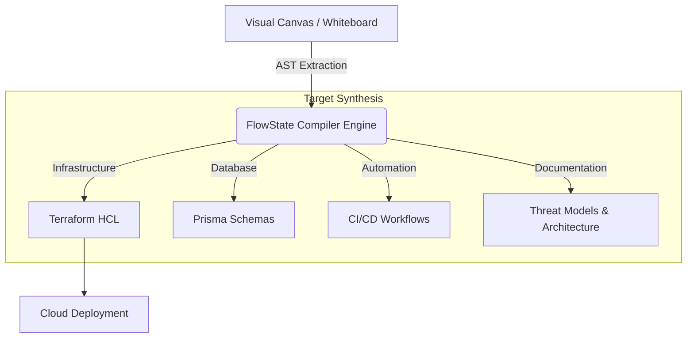

# Genesis FlowState

  

**FlowState** is a next-generation Visual Compiler and IDE for Cloud Engineers. It bridges the gap between system architecture design and Infrastructure as Code (IaC) by allowing you to design system topologies on an interactive visual canvas and automatically compile them into clean, ready-to-deploy HashiCorp Terraform configurations, Prisma schemas, and comprehensive documentation.

## 🚀 Features

- **Visual Architecture Canvas**: Design your cloud infrastructure using an intuitive drag-and-drop whiteboard. No more mental mapping—see your architecture as you build it.
- **Instant IaC Compilation**: FlowState automatically compiles your visual nodes and connections into production-ready HashiCorp HCL (Terraform) with zero legacy dependencies.
- **Vibe Coding Environment**: A fully integrated, browser-based mock IDE experience that lets you review multi-language targets, run live security audits, and view output logs natively tied to your diagram.
- **Real-Time Security Auditing**: Automatically generates threat models and architecture documentation, validating rules like encryptions (SSE-KMS) and permissive Security Groups.
- **B2B SaaS Ready**: Beautiful, high-performance dark-mode interface built with modern web aesthetics, dynamic scroll animations, and interactive elements.
- **Architecture Templates**: Built-in interactive playgrounds for standard three-tier web apps, serverless REST APIs, and event-driven microservices.
- **Codebase Tours**: Point Genesis at any public GitHub repo and it analyzes the codebase with Gemini to generate a guided tour — an interactive radial mind map of the architecture (project overview, tech stack, component relationships, key user flows), plus narrated per-file stops with AI-generated voice narration and key takeaways.
- **Design Docs**: Create and review architecture decision docs, link them to approved designs, and let Genesis continuously scan incoming commits for drift against the documented decision.

## 🧠 How It Works

FlowState parses the visual graph (nodes and edges) from your whiteboard session and translates it into an Abstract Syntax Tree (AST). The internal compiler then synthesizes this AST into various development artifacts.



1. **Design**: Drag and drop nodes representing cloud primitives (ALBs, EC2 ASGs, DynamoDB, Lambda, etc.) on the canvas.
2. **Compile**: Click to run the FlowState compiler. The visual AST is parsed in real-time.
3. **Review**: Check the generated artifacts in the built-in IDE environment. Review Terraform `.tf` files, Prisma schemas, and GitHub Actions workflows.
4. **Deploy**: Take the synthesized code and run it in your CLI to deploy your robust, automated architecture.

## ⚡ Custom Binary WebSocket Protocol

FlowState features a highly optimized, custom binary protocol over WebSockets for zero-latency AI communication. Designed for performance, it bypasses heavy JSON payloads for continuous, high-frequency data streams.

### Protocol Structure
Communication is structured using a simple 1-byte prefix tag followed by the raw binary payload:

- **\`0x01\` (\`TAG_AUDIO\`)**: *Client-to-Server*. Streams user voice data in raw \`PCM\` format (16kHz, mono, Int16) directly from a custom \`AudioWorklet\`. Ensures ultra-low latency Voice Activity Detection (VAD) without dropping samples.
- **\`0x02\` (\`TAG_IMAGE\`)**: *Client-to-Server*. Synchronizes the visual whiteboard canvas by transmitting the graph state as an optimized binary blob.
- **\`0x03\` (\`TAG_TEXT\`)**: *Client-to-Server*. Encodes standard chat messages as UTF-8 binary payloads.
- **\`0x04\` (\`TAG_LIBRARY\`)**: *Client-to-Server*. Synchronizes the user's component library dynamically.
- **\`0xA1\` (\`TAG_AI_AUDIO\`)**: *Server-to-Client*. Streams the AI's generated response as high-quality \`PCM\` audio (24kHz, Float32) for instant playback.

This tag-based routing approach guarantees minimal overhead, making the interactive "Vibe Coding" session feel native and real-time.


## 🛠️ Technology Stack

- **Framework**: [Next.js 14](https://nextjs.org/) (App Router)
- **Language**: [TypeScript](https://www.typescriptlang.org/)
- **Styling**: [Tailwind CSS](https://tailwindcss.com/)
- **Animations**: [Framer Motion](https://www.framer.com/motion/) for fluid, declarative scroll and interactive animations.
- **3D / WebGL**: [OGL](https://github.com/oframe/ogl) for high-performance, lightweight WebGL backgrounds (Lightfall, LightPillar).
- **Icons**: [Lucide React](https://lucide.dev/)
- **State Management**: React Hooks (`useState`, `useEffect`, `useTransform`)
- **Authentication**: [Supabase Auth](https://supabase.com/auth) (email OTP sign-up, session-based `useAuth` hook).
- **Database**: PostgreSQL via [Supabase](https://supabase.com/) + [Prisma ORM](https://www.prisma.io/).
- **AI**: [Google Gemini](https://ai.google.dev/) for codebase analysis, tour narration, and design-doc drift detection.
- **Notifications**: [Sonner](https://sonner.emilkowal.ski/) toasts.

## 💻 Getting Started

### Prerequisites

- Node.js 18.x or higher
- npm or yarn

### Installation

1. Clone the repository:
   ```bash
   git clone https://github.com/Vishal-V-D/Genesis-Flowstate.git
   cd Genesis-Flowstate
   ```

2. Install dependencies:
   ```bash
   npm install
   ```

3. Configure environment variables — copy the example and fill it in:
   ```bash
   cp .env.example .env
   ```

   | Variable | Required | Description |
   |----------|----------|-------------|
   | `NEXT_PUBLIC_SUPABASE_URL` | Yes | Supabase project URL |
   | `NEXT_PUBLIC_SUPABASE_ANON_KEY` | Yes | Supabase anon/public key |
   | `SUPABASE_SERVICE_ROLE_KEY` | Yes | Server-side only — never exposed to the browser |
   | `NEXT_PUBLIC_SITE_URL` | Yes | Used for auth redirect URLs, e.g. `http://localhost:3000` |
   | `NEXT_PUBLIC_BACKEND_WS_URL` | Yes | Backend WebSocket URL. Local: `ws://localhost:8000` |
   | `DATABASE_URL` | Yes | Supabase Postgres, transaction-mode pooler (port 6543), used by Prisma at runtime |
   | `DIRECT_URL` | Yes | Supabase Postgres, session-mode pooler (port 5432), used for `prisma db push` |
   | `GEMINI_API_KEY` | Yes | Google Gemini key — powers codebase analysis, tour narration, drift detection |
   | `GITHUB_TOKEN` | Optional | Raises GitHub API rate limits for repo analysis |

   In the Supabase dashboard, also enable **Auth → Email → Email OTP** so sign-up
   verification works with 6-digit codes.

4. Push the Prisma schema to your database:
   ```bash
   npx prisma db push
   npx prisma generate
   ```

5. Run the development server:
   ```bash
   npm run dev
   ```

6. Open [http://localhost:3000](http://localhost:3000) with your browser.

> **Backend required:** Genesis talks to the FlowState backend for the live AI,
> diagram generation, review, cost and artifact features. Run it locally
> (see [FlowState-Backend](https://github.com/Vishal-V-D/FlowState-Backend)) or
> point `NEXT_PUBLIC_BACKEND_WS_URL` at the deployed backend.

### Deployment

The frontend deploys to any Next.js-compatible host (Vercel, etc). Set the
environment variables above in your hosting provider's dashboard, and point
`DATABASE_URL`/`DIRECT_URL` at your Supabase project's connection strings.

## 🏗️ Project Structure

- \`src/app\`: Next.js App Router pages and layouts.
- \`src/app/codebase-tours\`: Guided codebase tours — repo analysis, radial architecture mind map, AI narration.
- \`src/app/design-docs\`: Architecture decision docs with AI-powered drift scanning against commits.
- \`src/app/api\`: Route handlers for tours, design docs, repos, workspaces, and user profile.
- \`src/components/landing\`: Modular UI components for the landing page (e.g., \`PricingSection\`, \`SandboxSection\`, \`IDEPreviewSection\`).
- \`src/components/ui\`: Reusable UI elements and complex WebGL components like \`Lightfall\` and \`LightPillar\`.
- \`src/hooks\`: Custom React hooks for authentication and state management.
- \`src/lib\`: Supabase client/server helpers, Prisma client, auth verification.
- \`prisma/schema.prisma\`: Database schema (users, workspaces, design docs, codebase tours, tour stops/progress).

## 📄 License

This project is licensed under the MIT License.
